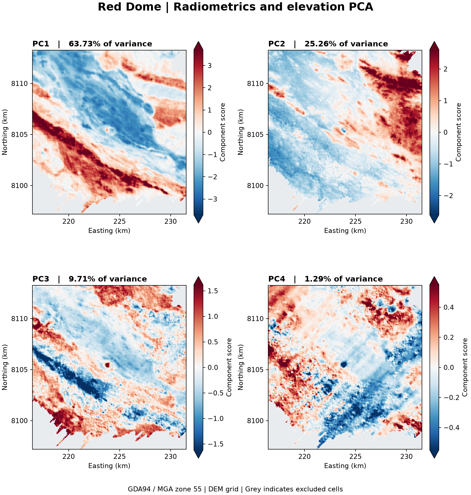

#PCA of digital elevation model and radiometrics (K, Th, U):  finding the hard-rock effects on radiometrics

The radiometrics map might help to identify which lithological units have a specific signature on a decomposed radiometric map (U, Th and K). K is usually associated with 
either felsic rocks or sediment. U tends to be associated with zircon and/or monazite.

